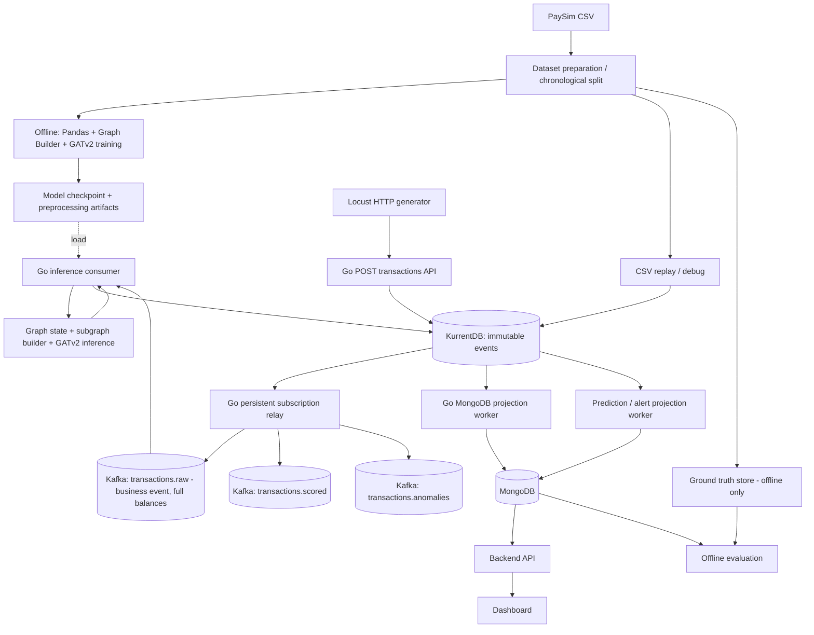

# Technical Design: Kafka + GATv2 + MongoDB cho PaySim

**Phiên bản:** 2.0  
**Trạng thái:** Thiết kế đề xuất — các hợp đồng cần được hai thành viên xác nhận trước khi code  
**Dataset:** [PaySim — Synthetic Financial Datasets For Fraud Detection](https://www.kaggle.com/datasets/ealaxi/paysim1)  
**Phạm vi:** Đồ án Big Data, hệ thống phát hiện giao dịch tài chính bất thường theo kiến trúc event-driven.

## 1. Mục tiêu và phân công

- **Thành viên Kafka:** Docker Compose / Kafka, topic, CSV replay producer, consumer adapter, result publisher, MongoDB sink, retry, offset, logging, benchmark.
- **Thành viên AI:** khám phá PaySim, chia dữ liệu train/validation/test theo thời gian, feature engineering, graph builder, GATv2 train/evaluate, inference interface, graph state và phương án khôi phục.
- **Tích hợp chung:** JSON event contracts, thứ tự phát lại, cơ chế xử lý trùng, mapping transaction ID, interface inference.

Kafka **không chạy mô hình**, không xử lý graph thay nhóm AI. Pandas là thư viện biến đổi dữ liệu dạng bảng, **không phải** stream processing engine; state/window/recovery phải do inference pipeline tự đảm nhiệm.

## 2. Kiến trúc tổng quan



**MVP:** 1 Kafka broker, 1 partition/topic, 1 inference consumer, MongoDB. Chưa thiết kế mở rộng consumer song song khi graph state còn chia sẻ trong RAM.

### Quyết định triển khai runtime

- Runtime producer, inference consumer, MongoDB sinks và API được triển khai bằng
  Go. Offline preparation/evaluation có thể tiếp tục dùng Python vì không nằm
  trong runtime streaming.
- KurrentDB (EventStoreDB) là **event store/source of truth**. Raw, scored,
  anomaly và DLQ phải append vào KurrentDB trước; chỉ relay được publish Kafka.
  Relay dùng persistent subscription và ACK sau Kafka acknowledge (at-least-once).
  MongoDB chỉ là read-model projection; demo mới rebuild trực tiếp KurrentDB →
  projection worker → MongoDB, không phụ thuộc Kafka. Sinks Kafka cũ giữ cho debug.
  Stream event bất biến dùng ID ổn định và expected revision NoStream; payload
  xung đột phải fail, không overwrite. Labels chỉ offline, không vào event store.
- GATv2 được tích hợp qua Go inference interface trước; MVP dùng mock engine.
  Việc đưa checkpoint/model thật vào interface vẫn thuộc phạm vi AI.

### Demo runtime một process

- `server/cmd/app` gom HTTP API, KurrentDB projection worker, Kafka relay và
  inference Kafka consumer vào một process; frontend React là client riêng.
- Locust gọi `POST /api/v1/transactions` với raw DTO v2, không gửi labels.
  API validate và append KurrentDB trước khi trả 202. ID/payload retry ổn định;
  conflict → 409, validation → 400, event store unavailable → 503.
- Hai nhánh độc lập dùng hai persistent subscriptions: KurrentDB → MongoDB,
  KurrentDB → Kafka. ACK chỉ sau side effect nhánh đó thành công.
- Inference vẫn đọc Kafka; ghi scored/anomaly/DLQ vào KurrentDB trước commit
  raw offset. Kết quả được projection trực tiếp MongoDB và relay sang Kafka.
- Model mock/stateless hiện tại không quyết định graph target/window/timing.
  Online HTTP concurrent append không có bảo đảm sort theo PaySim step.
- `make demo-infra`, `make server`, `make web`, `make locust` là các entrypoints
  demo. Không cần chạy producer/relay/sink riêng. Shutdown bằng Ctrl+C.

## 3. Schema thực tế PaySim

PaySim gồm **11 cột**: `step`, `type`, `amount`, `nameOrig`, `oldbalanceOrg`, `newbalanceOrig`, `nameDest`, `oldbalanceDest`, `newbalanceDest`, `isFraud`, `isFlaggedFraud`.

| Cột | Kiểu JSON đề xuất | Ý nghĩa / lưu ý |
|---|---|---|
| `step` | integer | Giờ mô phỏng, **1 step = 1 giờ**. Không phải timestamp UTC. |
| `type` | string | `CASH_IN`, `CASH_OUT`, `DEBIT`, `PAYMENT`, `TRANSFER`. |
| `amount` | number | Số tiền trong đơn vị mô phỏng của dataset; không gán mặc định VND. |
| `nameOrig` | string | Tài khoản nguồn. |
| `oldbalanceOrg` | number | Số dư nguồn trước giao dịch. |
| `newbalanceOrig` | number | Số dư nguồn sau giao dịch. |
| `nameDest` | string | Tài khoản đích. |
| `oldbalanceDest` | number | Số dư đích trước giao dịch. |
| `newbalanceDest` | number | Số dư đích sau giao dịch. |
| `isFraud` | integer (0/1) | Nhãn ground truth — **không** đưa vào input inference. |
| `isFlaggedFraud` | integer (0/1) | Kết quả rule từ dataset — **không** đưa vào input inference. |

**Quy tắc v2:** Giữ **bốn cột balance** trong event nghiệp vụ `transactions.raw` và trong kho giao dịch MongoDB, vì chúng là một phần bản ghi PaySim và hữu ích cho lưu trữ/đối soát/thống kê. **Không đưa bốn cột balance vào feature của GATv2**, ở cả **training và online inference**, theo cảnh báo của tác giả PaySim: giao dịch được phát hiện gian lận bị hủy nên dữ liệu số dư có thể phản ánh kết quả xử lý sau phát hiện. `isFraud` và `isFlaggedFraud` được tách khỏi event đầu vào inference; `isFraud` chỉ làm ground truth cho train/evaluation (theo split), `isFlaggedFraud` là cờ rule mô phỏng dùng để phân tích riêng, không làm feature.

**Phân biệt thời điểm dữ liệu:** `oldbalanceOrg`/`oldbalanceDest` mang nghĩa số dư trước giao dịch còn `newbalanceOrig`/`newbalanceDest` là số dư sau giao dịch; PaySim là dữ liệu hậu mô phỏng, vì thế event replay đầy đủ phục vụ **lưu trữ nghiên cứu** không đồng nghĩa tất cả cột đều sẵn có tại thời điểm ra quyết định trong hệ thống thanh toán thực. Không dùng các cột sau giao dịch để mô phỏng pre-transaction fraud blocking.

### Vì sao phải giữ `step`?

- Duy trì thứ tự theo **giờ mô phỏng** để replay giao dịch.
- Xây graph theo thời gian và tạo sliding window, chẳng hạn **5 step = 5 giờ mô phỏng**, không phải 5 phút.
- Chia train/test theo thời gian và tránh sử dụng thông tin từ các step tương lai.
- Khi các giao dịch cùng `step`, dataset không cung cấp thứ tự thời gian chi tiết; dùng số thứ tự dòng CSV như tie-breaker **kỹ thuật**, không suy diễn đây là thứ tự thực tế.

Không thay `step` bằng Kafka ingestion timestamp để mô hình học hành vi theo thời gian.

## 4. Event contract (JSON)

Các trường `schemaVersion`, `transactionId`, `sourceRowIndex`, `processedAt`, `modelVersion` là **trường do hệ thống bổ sung**, không phải cột gốc PaySim.

### 4.1. RawTransactionEvent (Transaction DTO) → `transactions.raw`

**v2: gửi toàn bộ trường giao dịch nghiệp vụ, bao gồm bốn trường số dư; không gửi hai nhãn `isFraud`/`isFlaggedFraud` trong luồng inference.**

```json
{
  "schemaVersion": 2,
  "transactionId": "paysim-0",
  "sourceRowIndex": 0,
  "step": 1,
  "type": "PAYMENT",
  "amount": 9839.64,
  "nameOrig": "C1231006815",
  "oldbalanceOrg": 170136.0,
  "newbalanceOrig": 160296.36,
  "nameDest": "M1979787155",
  "oldbalanceDest": 0.0,
  "newbalanceDest": 0.0
}
```

- **Kafka key:** `nameOrig` (tài khoản gửi).
- `transactionId = "paysim-" + sourceRowIndex` với row index cố định, tính từ 0, không tính header; ổn định khi replay **cùng một file nguồn**. Nếu đổi file / thứ tự dòng, thêm `datasetVersion` vào ID.
- Số tiền trong JSON dùng `number` để đơn giản hóa demo; nếu cần tính tiền tuyệt đối chính xác, cân nhắc biểu diễn decimal dạng string hoặc integer scaled units và thống nhất contract.
- Không tạo `timestamp` hoặc `currency` giả định là dữ liệu thật của PaySim.
- **Giữ** bốn trường balance trong `transactions.raw`, lưu trữ MongoDB raw transactions và phân tích nghiệp vụ.
- **Không** đưa `isFraud`, `isFlaggedFraud` vào raw event production-like; lưu nhãn ở ground-truth store riêng.
- Không suy ra currency là VND và không tự tạo transaction timestamp thật từ `step`.

### 4.2. ModelInputDTO / InferenceTransactionDTO (interface nội bộ Python)

**Feature selection là bước chuyển từ Transaction DTO sang Model Input DTO trong AI pipeline.** DTO này được dùng cho **cả training và inference**, không phải chỉ loại balance trong lúc train. Không gửi số dư hay nhãn từ adapter cho graph builder hoặc model.

```python
from typing import Literal
from pydantic import BaseModel, Field

TransactionType = Literal["CASH_IN", "CASH_OUT", "DEBIT", "PAYMENT", "TRANSFER"]

class InferenceTransactionDTO(BaseModel):
    transactionId: str
    sourceRowIndex: int = Field(ge=0)
    step: int = Field(ge=1)
    type: TransactionType
    amount: float = Field(ge=0)
    nameOrig: str
    nameDest: str
```

- `transactionId` là identifier; `nameOrig`/`nameDest` là định danh node; không mặc định đưa các ID vào vector feature dưới dạng số.
- **Không có** `oldbalanceOrg`, `newbalanceOrig`, `oldbalanceDest`, `newbalanceDest`, `isFraud`, `isFlaggedFraud` trong Model Input DTO.
- Graph builder quyết định node/edge features, window và inference semantics.
- Mục tiêu đầu ra **đề xuất**: dự đoán bất thường **cho mỗi transaction (edge-level)**. Nếu nhóm AI chọn node-level, cần cập nhật contract kết quả.
- Nếu batch có nhiều giao dịch, output **phải map đúng `transactionId`**, không được dựa duy nhất vào thứ tự list nếu pipeline có sắp xếp/lọc.

### 4.3. TransactionPredictionEvent → `transactions.scored`

```json
{
  "schemaVersion": 1,
  "transactionId": "paysim-0",
  "step": 1,
  "anomalyScore": 0.87,
  "isAnomaly": true,
  "modelVersion": "gatv2-v1",
  "processedAt": "2026-10-13T15:00:01Z",
  "reasonCodes": []
}
```

- Ví dụ chỉ mang tính minh họa; score không phải kết quả mô hình thực tế.
- Nếu `anomalyScore` được công bố là xác suất/điểm 0–1, nhóm AI cần định nghĩa cách chuyển đổi và threshold. Không giả định raw logits tự thuộc [0,1].
- `reasonCodes` để trống nếu mô hình không có cơ chế giải thích hợp lệ; không suy diễn nguyên nhân trực tiếp từ attention weights.
- Event có `isAnomaly=true` cũng được publish vào `transactions.anomalies` (có thể reuse schema này ở MVP).

### 4.4. GroundTruthDTO — chỉ sử dụng offline

```json
{
  "transactionId": "paysim-0",
  "step": 1,
  "isFraud": 0,
  "isFlaggedFraud": 0
}
```

Lưu trong CSV/Parquet riêng hoặc MongoDB collection `transaction_ground_truth` có quyền truy cập giới hạn ở evaluation pipeline. **Inference consumer không truy vấn nhãn.**

### 4.5. DLQ event → `transactions.dlq`

```json
{
  "sourceTopic": "transactions.raw",
  "sourcePartition": 0,
  "sourceOffset": 125,
  "errorCode": "INVALID_SCHEMA",
  "errorMessage": "Missing transactionId",
  "failedAt": "2026-10-13T15:00:02Z",
  "originalPayload": { }
}
```

Phải xác nhận DLQ publish thành công trước khi bỏ qua record lỗi. Không gửi lỗi broker tạm thời vào DLQ ngay lập tức; retry có backoff.

### 4.6. DTO Python của transaction nghiệp vụ (tham chiếu)

```python
from typing import Literal
from pydantic import BaseModel, Field

TransactionType = Literal["CASH_IN", "CASH_OUT", "DEBIT", "PAYMENT", "TRANSFER"]

class RawTransactionEvent(BaseModel):
    schemaVersion: int = 2
    transactionId: str
    sourceRowIndex: int = Field(ge=0)
    step: int = Field(ge=1)
    type: TransactionType
    amount: float = Field(ge=0)
    nameOrig: str
    oldbalanceOrg: float
    newbalanceOrig: float
    nameDest: str
    oldbalanceDest: float
    newbalanceDest: float

class ModelInputDTO(BaseModel):
    transactionId: str
    sourceRowIndex: int = Field(ge=0)
    step: int = Field(ge=1)
    type: TransactionType
    amount: float = Field(ge=0)
    nameOrig: str
    nameDest: str


def to_model_input(raw: RawTransactionEvent) -> ModelInputDTO:
    # Whitelist: không dùng exclude-list để tránh lộ feature khi schema raw mở rộng.
    return ModelInputDTO(
        transactionId=raw.transactionId,
        sourceRowIndex=raw.sourceRowIndex,
        step=raw.step,
        type=raw.type,
        amount=raw.amount,
        nameOrig=raw.nameOrig,
        nameDest=raw.nameDest,
    )
```

**Ví dụ kiểm tra bắt buộc:** `assert not any(k in to_model_input(raw).model_dump() for k in ("oldbalanceOrg", "newbalanceOrig", "oldbalanceDest", "newbalanceDest", "isFraud", "isFlaggedFraud"))`.

## 5. Topics, groups và trách nhiệm

| Topic | Producer | Consumer / group | Mục đích |
|---|---|---|---|
| `transactions.raw` | PaySim replay producer | `gatv2-inference-group`, `mongodb-raw-sink-group` | Giao dịch nghiệp vụ đầy đủ (gồm balance, không gồm labels) |
| `transactions.scored` | Inference result publisher | `mongodb-sink-group` | Dự đoán của tất cả giao dịch |
| `transactions.anomalies` | Inference result publisher | `alert-group` | Cảnh báo bất thường |
| `transactions.dlq` | Error handlers | Debug/reprocessing | Event có lỗi không thể xử lý thông thường |

**Cấu hình local mặc định:** 1 broker, 1 partition/topic, replication factor 1, JSON, retention 24 giờ, consumer manual commit. Đây không phải cấu hình HA cho production.

## 6. Runtime flow

1. **Replay Producer** đọc CSV theo `(step, sourceRowIndex)` và giữ `transactionId` ổn định; publish event nghiệp vụ có đầy đủ bốn balance; tách nhãn vào ground-truth store.
2. Producer serialize `RawTransactionEvent`, publish vào `transactions.raw`, theo dõi delivery acknowledgments và số event lỗi.
3. **Hai nhánh độc lập** đọc `transactions.raw`: (a) MongoDB raw sink lưu giao dịch nghiệp vụ, (b) Go inference consumer `FetchMessage` theo manual commit, validate schema, **whitelist field để tạo ModelInputDTO** rồi chuyển qua inference interface.
4. Adapter gọi `InferenceEngine.predict(model_input_batch)` do nhóm AI cung cấp. **Training và inference dùng cùng feature schema an toàn.** Engine cập nhật graph window, tạo subgraph và thực hiện GATv2 inference.
5. Result publisher ghi dự đoán vào `transactions.scored`, và thêm `transactions.anomalies` với giao dịch bị đánh dấu.
6. Inference consumer chỉ commit Kafka offset khi các kết quả append KurrentDB cần thiết đã được xác nhận **và** trạng thái graph có thể khôi phục tương ứng. Relay chịu trách nhiệm chuyển output sang Kafka và ACK subscription sau Kafka acknowledge. **Raw sink dùng offset của consumer group riêng**, commit sau khi MongoDB xác nhận upsert.
7. MongoDB sink tiêu thụ `transactions.scored`, `upsert` theo `(transactionId, modelVersion)`, rồi commit sink offset khi DB xác nhận.
8. Alert consumer lưu cảnh báo; Dashboard truy vấn qua Backend API.

### Ranh giới khôi phục graph state

**Không được coi graph state trong RAM là đã durable.** Nếu consumer restart từ committed offset nhưng graph state bị mất, inference các event tiếp theo có thể sai.

**MVP dễ kiểm soát:** chạy một inference consumer, tái tạo graph state bằng cách replay lịch sử cần thiết theo `step` (từ snapshot/checkpoint hoặc từ đầu một phân đoạn dữ liệu); chỉ phục vụ inference sau khi warm-up hoàn tất. Nếu không thể khôi phục đúng state thì không commit offset đi trước state khôi phục được. Mọi cập nhật state phải xử lý sự kiện trùng.

Để cải tiến có thể lưu checkpoint graph và metadata offset tương ứng; đây là phần việc AI + Kafka phối hợp.

## 7. Python integration interface

Đề xuất dùng interface class do nhóm AI triển khai:

```python
from typing import Protocol

class InferenceEngine(Protocol):
    def predict(self, transactions: list[dict]) -> list[dict]:
        """Return one prediction for each accepted transactionId.

        Implementation owns preprocessing, graph window, model inference,
        and recoverable state semantics.
        """
        ...
```

**Kafka adapter sở hữu:** deserialize/validate, batching, invoke model, publish, retry, offset, logging.  
**AI module sở hữu:** pretrained artifacts, feature schema, graph building, predict threshold, replay/state recovery.

Trước khi kết nối model thật, dùng mock predictor tạo điểm thử nghiệm **chỉ để kiểm thử wiring**, không dùng điểm giả cho báo cáo ML metrics.

## 8. Offset, retries, duplicate và event ordering

- Tắt `enable.auto.commit`; consumer cần quản lý offset theo **partition**, kể cả khi poll nhiều partition trong một batch.
- **At-least-once:** lỗi/restart có thể tạo duplicate processing/output; MongoDB upsert idempotently.
- Không coi `producer.send()` là publish thành công cho đến khi nhận delivery confirmation.
- Lỗi schema không hợp lệ: ghi DLQ thành công, sau đó mới đánh dấu record xử lý xong.
- Lỗi inference tạm thời: retry/backoff có giới hạn, sau đó pause/alert; không tự động bỏ sự kiện gây thất bại.
- Khi dùng key `nameOrig`, Kafka giữ thứ tự ghi trong **một partition**, không đảm bảo thứ tự toàn cục hoặc thứ tự thời gian thật. Sender và receiver có thể xuất hiện trên nhiều partition nếu tăng quy mô.
- Với graph toàn mạng, không tăng partition/consumer trước khi có thiết kế nhất quán cho shared graph state.
- `processedAt` là thời điểm hệ thống xử lý; `step` là giờ mô phỏng. Không trộn lẫn hai khái niệm.

## 9. MongoDB

Collection đề xuất:

- `transactions`: toàn bộ trường RawTransactionEvent (bao gồm bốn balance), **không** chứa `isFraud`/`isFlaggedFraud`; upsert theo `transactionId`.
- `transaction_predictions`: `transactionId`, `step`, `anomalyScore`, `isAnomaly`, `modelVersion`, `processedAt`, `reasonCodes`.
- `transaction_alerts`: dữ liệu cảnh báo, idempotent theo `(transactionId, modelVersion)`.
- `transaction_ground_truth`: nhãn offline, tách quyền truy cập khỏi consumer.

Index đề xuất:

```javascript
db.transactions.createIndex({ transactionId: 1 }, { unique: true });
db.transactions.createIndex({ step: 1 });

db.transaction_predictions.createIndex(
  { transactionId: 1, modelVersion: 1 },
  { unique: true }
);
db.transaction_predictions.createIndex({ step: 1, isAnomaly: 1 });
```

Không cần MongoDB để lưu mọi state nếu nhóm AI sử dụng snapshot file/memory có kiểm soát, nhưng phải tài liệu hóa recovery.

## 10. Checklist triển khai cho thành viên Kafka

### Phase A — Infrastructure
- [ ] Tạo `docker-compose.yml` cho Kafka và MongoDB.
- [ ] Cấu hình Kafka bootstrap address từ host/container phù hợp.
- [ ] Tạo bốn topics như Mục 5.
- [ ] Smoke test produce/consume event JSON.

### Phase B — Replay producer
- [ ] Đọc cột PaySim đúng tên, validate `step`, `amount`, `type`, `nameOrig`, `nameDest` và bốn balance.
- [ ] Tạo `transactionId` và `sourceRowIndex` ổn định.
- [ ] Publish RawTransactionEvent **đầy đủ bốn balance** lên `transactions.raw`.
- [ ] Ghi nhãn ground truth ngoài inference stream.
- [ ] Publish theo `(step, sourceRowIndex)`, log success/error counts.
- [ ] Có `events_per_second` configurable để làm benchmark (ví dụ 100/500/1.000).

### Phase C — Consumer adapter / publisher
- [ ] Subscribe `transactions.raw`.
- [ ] Validate JSON và schemaVersion.
- [ ] Whitelist tạo ModelInputDTO, không đưa bốn balance hoặc labels vào AI.
- [ ] Gom micro-batch configurable.
- [ ] Tích hợp mock `InferenceEngine` trước.
- [ ] Publish `transactions.scored` và `transactions.anomalies` theo đúng contract.
- [ ] Manual commit có per-partition progress tracking.
- [ ] Error handling, DLQ và retry.

### Phase D — Integration / persistence
- [ ] Kết nối model inference thật của nhóm AI.
- [ ] Xác nhận state replay/warm-up trước khi chạy end-to-end.
- [ ] MongoDB raw sink lưu đầy đủ transaction fields (gồm balance) qua consumer group riêng.
- [ ] MongoDB prediction sink với idempotent upsert.
- [ ] Test consumer restart, duplicate transaction và downstream outage.

### Phase E — Observability / experiments
- [ ] Metrics: producer rate, consumer throughput, lag, inference latency, end-to-end latency, failed records.
- [ ] Các thử nghiệm tải 100/500/1.000 events/s (các target cần đo, không phải kết quả có sẵn).
- [ ] Log model version, batch size, graph window (`step`), dataset version, hardware config.

## 11. Integration test cases

| ID | Test | Kết quả mong đợi |
|---|---|---|
| INT-01 | Replay 100 hàng CSV | 100 raw events có `transactionId` ổn định |
| INT-02 | Data sai `type` hoặc thiếu `step` | Validate fail, sự kiện vào DLQ theo chính sách |
| INT-03 | Replay cùng file hai lần | Không nhân đôi prediction documents của cùng modelVersion |
| INT-04 | `step=1,1,2,3` | Producer replay đúng thứ tự bước mô phỏng |
| INT-05 | Consumer restart | Resume đúng offset **và** graph state |
| INT-06 | Inference mock trả `isAnomaly=true` | Có scored + anomaly event tương ứng |
| INT-07 | MongoDB bị ngắt kết nối | Sink retry, không commit bản ghi chưa lưu |
| INT-08 | Publish thất bại | Không mark input batch hoàn tất |
| INT-09 | Input rate lớn hơn throughput | Consumer lag tăng và được quan sát |
| INT-10 | Ground truth là 1 trong CSV | Không xuất hiện trong feature/DTO của inference |
| INT-11 | Raw event có đủ 4 balance | MongoDB `transactions` lưu đủ; ModelInputDTO không có 4 field này |
| INT-12 | Train và online inference cùng giao dịch | Tạo đúng cùng feature schema, không leakage từ balance hoặc label |

## 12. Đánh giá đồ án

**Đánh giá phát hiện gian lận** (dựa trên dữ liệu có nhãn `isFraud`): Precision, Recall, F1, PR-AUC, confusion matrix; so sánh GATv2 với baseline cùng split. Tránh dùng test labels vào graph feature selection hoặc threshold tuning.

**Đánh giá hệ thống:** throughput (events/s), end-to-end latency (p50/p95/p99), inference batch latency, lag, error rate, restart/replay, duplicate handling. Tách **latency nhận vào Kafka** và **latency hoàn tất inference**.

**Đồ thị/dashboard:** lưu lượng giao dịch theo `step`, tỷ lệ dự đoán bất thường, phân phối score, biểu đồ PR, bảng top giao dịch nghi vấn, consumer lag theo thời gian.

## 13. Những quyết định phải chốt trước khi tích hợp

1. GATv2 dự đoán **edge/transaction-level** hay node-level?
2. Window tính theo bao nhiêu `step` và có cần graph history dài hạn?
3. Inference có dùng giao dịch hiện tại khi cập nhật graph trước dự đoán không? Có đảm bảo không dùng tương lai?
4. Cách replay/checkpoint graph state và offset nhất quán?
5. Thang điểm `anomalyScore` và ngưỡng `isAnomaly`?
6. Size micro-batch / thời gian đợi tối đa?
7. Chỉ xử lý `TRANSFER`/`CASH_OUT` hay toàn bộ loại giao dịch? Không thay đổi thứ tự/nội dung replay nếu chưa có quyết định rõ.
8. Đánh giá trên split nào, có tách nhãn hoàn toàn khỏi inference hay không?

## 14. Tiêu chí nghiệm thu MVP

- Producer replay PaySim CSV đúng schema và theo `step`.
- Kafka nhận/phân phối raw events; consumer gọi mock hoặc real model thành công.
- Mọi prediction publish ra `transactions.scored`, anomalies vào topic riêng.
- MongoDB lưu prediction idempotent, không lặp bản ghi khi replay.
- Nhãn PaySim không rò rỉ vào inference features; **4 balance vẫn lưu tại raw event và MongoDB, nhưng không dùng cho training/inference**.
- Có cách khôi phục graph state tương ứng committed offset; test restart pass.
- Có log/metrics và tối thiểu ba kịch bản benchmark tải.
- README mô tả lệnh chạy, biến môi trường và cách kiểm chứng luồng end-to-end.

---

**Thay đổi v2 so với v1.1:** `transactions.raw` giờ chứa 4 cột balance; thêm MongoDB raw transaction sink; mô tả rõ whitelist chuyển `RawTransactionEvent → ModelInputDTO`, cùng feature schema cho training và inference; bổ sung test chống leakage và lưu raw. Hai nhãn `isFraud`/`isFlaggedFraud` vẫn tách riêng khỏi inference stream.

**Ghi chú:** Các giá trị trong JSON event là minh họa, không phải dữ liệu dự đoán hoặc số liệu đo thực nghiệm. Tài liệu này là hợp đồng triển khai đề xuất; điều chỉnh sau khi nhóm AI chốt graph construction và model input thực tế.
